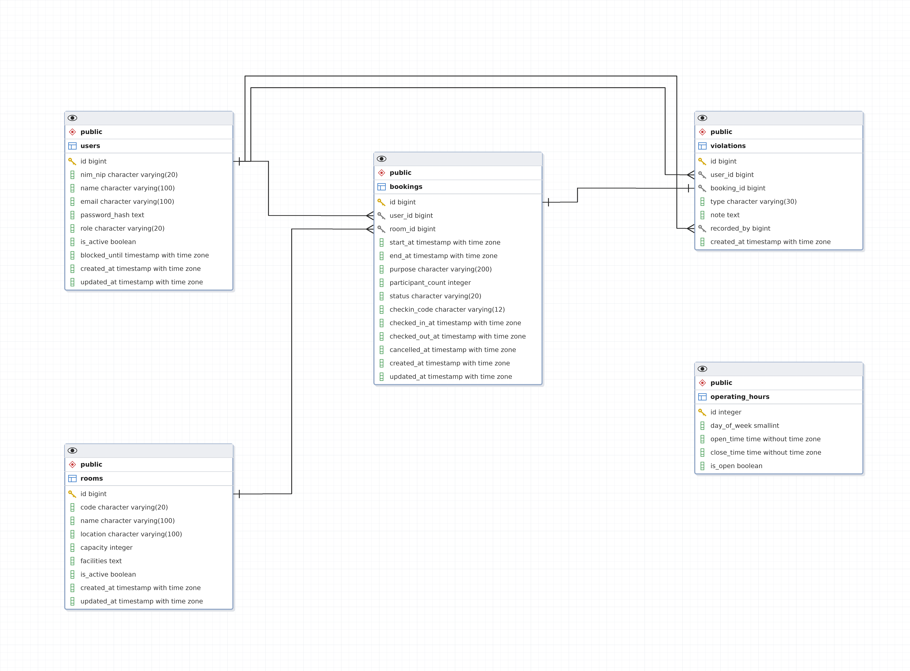

# ERD RuangKu

Database PostgreSQL terdiri dari 5 tabel: `users`, `rooms`, `operating_hours`, `bookings`, dan `violations`.

## Penjelasan relasi

| Relasi | Kardinalitas | Keterangan |
|---|---|---|
| users → bookings | 1 : N | Satu mahasiswa bisa punya banyak booking (maksimal 1 booking aktif per hari). |
| rooms → bookings | 1 : N | Satu ruang bisa dibooking berkali-kali di jam yang berbeda. |
| users → violations | 1 : N | Riwayat pelanggaran mahasiswa. 3 pelanggaran = diblokir 7 hari (`blocked_until`). |
| bookings → violations | 1 : 0..1 | Satu booking paling banyak menghasilkan satu pelanggaran (`booking_id` UNIQUE). |
| users (petugas) → violations | 1 : N | `recorded_by` berisi petugas yang mencatat, kosong bila dicatat otomatis oleh sistem. |
| operating_hours | berdiri sendiri | Jam buka perpustakaan per hari, dipakai saat cek ketersediaan ruang. |

## Constraint penting

- `users.email` dan `users.nim_nip` unik, `role` hanya `mahasiswa`, `petugas`, atau `admin`.
- `rooms.code` unik dan `capacity > 0`.
- `operating_hours`: jam tutup harus lebih besar dari jam buka bila hari itu buka.
- `bookings`: `end_at > start_at`, `participant_count > 0`, `checkin_code` unik, dan `status` hanya `booked`, `checked_in`, `completed`, `cancelled`, atau `no_show`.
